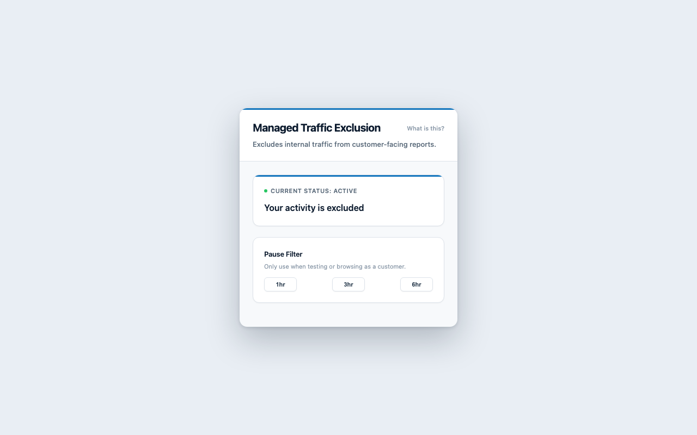
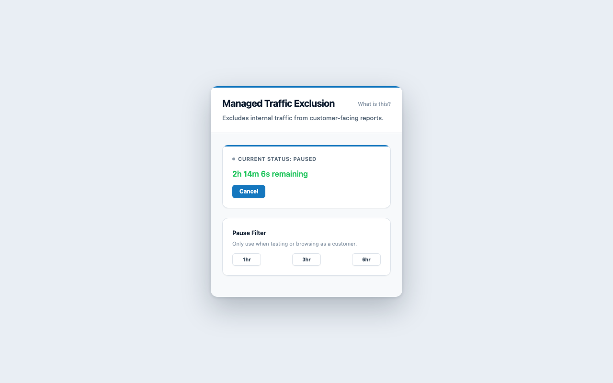

# Managed Traffic Exclusion

## Overview

Managed Traffic Exclusion is a Chrome and Edge extension that keeps internal staff browsing out of analytics and reporting on the company's managed websites.

On every page of a managed domain, the extension sets a JavaScript flag before any other script runs:

```
window.isManagedInternalTraffic = true
```

Google Tag Manager (GTM) or any other tag platform can read that flag and skip tracking tags when it is present. Only browsers with the extension installed are affected, and only on the domains listed in `manifest.json`.

## Why an Extension Instead of IP Filtering

Internal staff are often the largest source of noise in analytics and CRM data. Developers, marketers and sales teams visit the company's own sites every day, and every test click, form submission or refresh lands in the reports as if it came from a customer.

IP-based exclusions no longer work reliably. With hybrid and remote work, staff connect from home networks, cafés and VPNs, and their addresses change constantly.

A managed browser extension solves this at the source:

- **Deployed centrally.** Organisations on Google Workspace or Microsoft 365 can force-install the extension through Google Admin, Microsoft Intune or Group Policy. Every managed browser gets it automatically, and updates roll out without any action from staff.
- **Runs before tracking loads.** The content script runs at `document_start` and sets the flag before Google Tag Manager or any analytics script executes, so there is no race condition.
- **Precise.** Only browsers with the extension are affected, and only on the listed domains. Customers are never excluded by mistake.
- **Private by design.** Nothing is collected or transmitted. The only thing stored is a local timestamp for the pause feature.
- **No site changes needed.** Once the Tag Manager rule exists, the analytics team controls exclusions without touching the website's code.

## Screenshots

| Filter active | Filter paused |
| --- | --- |
|  |  |

## How It Works

- A content script runs at `document_start` in the page's main world and injects a small inline script as the first element in `<head>`, so the flag exists before any analytics script loads.
- The content script watches the document and moves the inline script back to the first position if the page inserts scripts ahead of it.
- A second content script in the isolated world relays extension storage to the page so the flag stays in sync with the pause state.
- Staff can pause the filter from the extension popup for 1, 3, or 6 hours. While paused, the flag is not set and the staff member's activity appears in reports as normal. The filter resumes automatically when the time runs out, or sooner if they press **Cancel**.
- There is no permanent opt-out. The only way to be excluded from the filter is a timed pause.

The pause end time is stored in `chrome.storage.local` under `unblockUntil` and mirrored into the page's `localStorage` as `mte_unblock_until`, so the inline script can check it synchronously at page load.

## Managed Domains

The extension currently applies to:

- `*.bbc.com`
- `*.bbc.co.uk`

To change the domains, edit `manifest.json` and update the same list in three places: `host_permissions` and the `matches` array of both `content_scripts` entries. Then update the `allowedHosts` list near the top of `popup.js` so the popup knows which sites are covered.

Each entry uses Chrome match-pattern syntax:

```
"*://*.example.com/*"
```

## Before You Deploy: Update `manifest.json`

Edit these fields in `manifest.json` before loading or publishing the extension:

| Field | What to set |
| --- | --- |
| `name` | The name staff will see in the browser and the Web Store. Currently `Managed Traffic Exclusion`. |
| `description` | A short, plain description. This is shown in the Web Store listing and on the extensions page. |
| `version` | Increase this on every release, for example `4.0.0` to `4.0.1`. The Web Store rejects uploads that reuse a version number. |
| `author` | The team or company name responsible for the extension. |
| `host_permissions` and `matches` | The managed domains (see the **Managed Domains** section above). |
| `icons` | Already set to the PNGs in `icons/` (16, 48 and 128 px). To change the artwork, edit `icons/icon.svg` and re-export the three sizes. The Web Store uses the 128 px version. |

## Installation

There are two ways to roll the extension out. **Loading unpacked** is for testing on a single machine. **Publishing to the Chrome Web Store** under the company developer account is how it should be deployed to staff.

### Option A: Load Unpacked (testing only)

#### Chrome

1. Open `chrome://extensions/`.
2. Turn on **Developer mode** in the top-right corner.
3. Click **Load unpacked** and select the `managed-traffic-exclusion` folder.
4. Open **Details** for the extension and enable **Allow in Incognito** if staff use private windows.

#### Edge

1. Open `edge://extensions/`.
2. Turn on **Developer mode** in the left-hand sidebar.
3. Click **Load unpacked** and select the `managed-traffic-exclusion` folder.
4. Open **Details** for the extension and enable **Allow in InPrivate** if needed.

After changing `manifest.json`, click the reload icon on the extension card and accept any new site-access prompt.

### Option B: Publish to the Chrome Web Store (company account)

Publish the extension from the **company's Chrome Web Store developer account**, not a personal one. This keeps ownership with the business, lets other team members manage updates, and is required if the extension will be force-installed through Google Admin.

1. **Prepare the package**
   - Complete the `manifest.json` changes above.
   - Zip only the files the extension needs: `manifest.json`, the five script and page files, and the `icons/` folder. Leave out `store/`, `README.md`, `LICENSE`, `.claude/` and any local notes. The `manifest.json` must be at the top level of the zip, not inside a subfolder.

2. **Upload**
   - Sign in to the [Chrome Web Store Developer Dashboard](https://chrome.google.com/webstore/devconsole) with the company developer account. If the account does not exist yet, it needs a one-off registration fee and should be set up with a shared company Google account or a publisher group, not an individual's login.
   - Click **New item**, upload the zip, and fill in the listing: description, category, the 128x128 icon from `icons/icon128.png`, and screenshots. Two ready-made 1280x800 screenshots are in `store/`: `screenshot-active.png` and `screenshot-paused.png`.

3. **Privacy and permissions**
   - Under **Privacy practices**, give a single-purpose description, for example: "Marks the browser as internal staff traffic on company websites so analytics tools can exclude it."
   - Justify each permission: `storage` (saves the pause end time), `scripting` (mirrors the pause state into the page), `activeTab` (reloads the current tab after a pause), and the host permissions (the managed domains).
   - State that the extension does not collect or transmit any user data. It stores only a timestamp locally.

4. **Visibility**
   - Set visibility to **Unlisted** or **Private**. Private restricts installation to users in the company's Google Workspace domain and is the right choice for a staff-only tool. Unlisted allows anyone with the link to install it.

5. **Submit for review** and wait for approval. Reviews usually take a few days. Host permissions for specific domains are low risk and normally pass without questions.

6. **Deploy to staff**

   Share the Web Store link for a manual install, or force-install it through the organisation's browser management tool so every managed browser receives it automatically and staff cannot remove it.

   **Google Admin console (Chrome on Workspace-managed devices)**
   - Go to **Devices** > **Chrome** > **Apps & extensions** > **Users & browsers**.
   - Select the organisational unit, click **+**, choose **Add Chrome app or extension by ID**, and paste the extension's Web Store ID.
   - Set the installation policy to **Force install** and save.

   **Microsoft Intune (Edge or Chrome on Microsoft 365-managed devices)**
   - For Edge: go to **Devices** > **Configuration** > **Create policy** > **Windows 10 and later** > **Settings catalog**. Search for **Control which extensions are installed silently** under Microsoft Edge, enable it, and add the extension ID. Edge can install Chrome Web Store extensions directly if the **Allow user-level native messaging** and Chrome Web Store update URL are set, or submit the same package to the Edge Add-ons store and use its ID instead.
   - For Chrome: import the Chrome ADMX templates into the Settings catalog, then use **Configure the list of force-installed apps and extensions** with the Web Store ID.
   - Assign the policy to the relevant device or user groups.

   **Group Policy (on-premises Active Directory)**
   - Install the Chrome or Edge ADMX templates on the domain controller.
   - Under **Computer Configuration** > **Administrative Templates** > **Google** > **Google Chrome** > **Extensions** (or the equivalent Microsoft Edge path), enable **Configure the list of force-installed apps and extensions** and add the extension ID.

7. **Updates**
   - For each new release, bump `version` in `manifest.json`, re-zip, upload the new package to the same item in the dashboard, and submit. Chrome updates installed copies automatically within a few hours of approval.

For Microsoft Edge, the same zip can be submitted to the [Edge Add-ons](https://partner.microsoft.com/dashboard/microsoftedge) partner centre under the company account, or staff can install the Chrome Web Store version directly in Edge.

## Using the Popup

Click the extension icon while on a managed site.

- **Current Status** shows whether the filter is active or paused, with a live countdown while paused.
- **Pause Filter** offers 1hr, 3hr, and 6hr buttons. Use these only when testing or browsing as a customer.
- **Cancel** appears while paused and resumes the filter immediately.
- **What is this?** explains the purpose of the extension to staff.

On any site that is not a managed domain, the popup shows a "No action needed" message and no controls.

## Testing

Use these checks after installing the extension, and again after any code change. Load the extension unpacked (Option A above) and reload it from the extensions page whenever you edit a file.

### 1. Confirm the flag is set on a managed site

1. Open a managed site, for example `https://www.bbc.co.uk`.
2. Open DevTools (`Cmd+Option+I` on Mac, `F12` on Windows) and go to the **Console** tab.
3. Make sure the context dropdown at the top left of the console says **top**, not the extension name.
4. Run:

```
window.isManagedInternalTraffic
```

Expected result: `true`.

### 2. Confirm the popup shows the active state

1. Click the extension icon in the toolbar while on the managed site.
2. The popup should show **Current Status: Active** with a green dot and the message "Your activity is excluded".
3. The 1hr, 3hr and 6hr buttons should be visible and the **Cancel** button hidden.

### 3. Pause the filter

1. In the popup, click **1hr**.
2. The page should reload itself and the popup should switch to **Current Status: Paused** with a live countdown and a **Cancel** button.
3. Back in the console, run the same check:

```
window.isManagedInternalTraffic
```

Expected result: `undefined`.

4. Optionally confirm the mirror the extension writes:

```
localStorage.getItem('mte_unblock_until')
```

Expected result: a timestamp in milliseconds roughly one hour ahead of now.

### 4. Cancel the pause

1. Click **Cancel** in the popup.
2. The page should reload and the popup should return to **Current Status: Active**.
3. In the console, `window.isManagedInternalTraffic` should be `true` again and the local storage key should be `null`.

### 5. Check another managed subdomain

1. While paused, navigate to a different managed origin, for example from `www.bbc.co.uk` to `www.bbc.com`.
2. Within a second of the page loading, `window.isManagedInternalTraffic` should be `undefined`. On the very first load of a new origin during a pause the flag can be present for a few milliseconds before extension storage clears it; reload once and it should be absent from the start.

### 6. Check a non-managed site

1. Open any site that is not in the managed domains list, for example `https://www.google.com`.
2. Click the extension icon. The popup should show the **No action needed** message with no pause buttons.
3. In the console, `window.isManagedInternalTraffic` should be `undefined`, because the content scripts do not run on this site.

### 7. Check the pause expires on its own

1. Pause for 1hr and leave the tab open.
2. After the hour, the popup countdown should return to **Active** and the page flag should be `true` again within five seconds, without reloading. Reloading the page also restores it immediately.

### 8. Verify the Google Tag Manager rule

1. In GTM, open **Preview** mode and connect it to a managed site.
2. With the filter active, select a page view event in the debugger and check the **Variables** tab. The **Managed Internal Traffic** variable should be `true`, and tags using the exclusion trigger as an exception should show as **not fired**.
3. Pause the filter, reload the page, and repeat. The variable should be `undefined` and the tags should fire.

### Troubleshooting

- **The flag stays `true` while paused.** Reload the extension on the extensions page, then reload the tab. Pages opened before an extension reload keep running the old content scripts.
- **The popup says "Extension reloaded. Please close and reopen this popup."** Close the popup and click the icon again. This happens when the extension was reloaded while the popup was open.
- **The popup shows "No action needed" on a managed site.** Check that the domain appears in both `manifest.json` and the `allowedHosts` list in `popup.js`, and that you reloaded the extension after editing them.

## Google Tag Manager Setup

1. **Create a variable**
   - Go to **Variables** > **New** > **JavaScript Variable**.
   - Set the global variable name to `isManagedInternalTraffic`.
   - Name the variable **Managed Internal Traffic**.

2. **Create a trigger**
   - Go to **Triggers** > **New** > **Page View** > **All Pages** or the event type your tags use.
   - Choose **Some Page Views** and set the condition: **Managed Internal Traffic** equals `true`.
   - Name the trigger **Internal Traffic Exclusion**.

3. **Apply the trigger as an exception**
   - Open each tracking tag (Google Analytics, advertising pixels, and so on).
   - Under **Triggering**, add **Internal Traffic Exclusion** as an **Exception**.

Because the flag is set before GTM loads, no race condition handling is needed. If you use a consent or data layer initialisation step, make sure the variable is read at tag fire time rather than cached earlier.

## Files

| File | Purpose |
| --- | --- |
| `manifest.json` | Extension metadata, permissions, and managed domains |
| `background.js` | Service worker that stores the pause state and syncs it to the active tab |
| `mainContentScript.js` | Sets the page flag and keeps it in place |
| `isolatedContentScript.js` | Bridges extension storage to the main-world script |
| `popup.html`, `popup.css`, `popup.js` | The popup interface |
| `icons/` | Extension and Web Store icons, with the source SVG |
| `store/` | Web Store listing screenshots (not shipped in the extension zip) |

## License

MIT License. See `LICENSE`.
